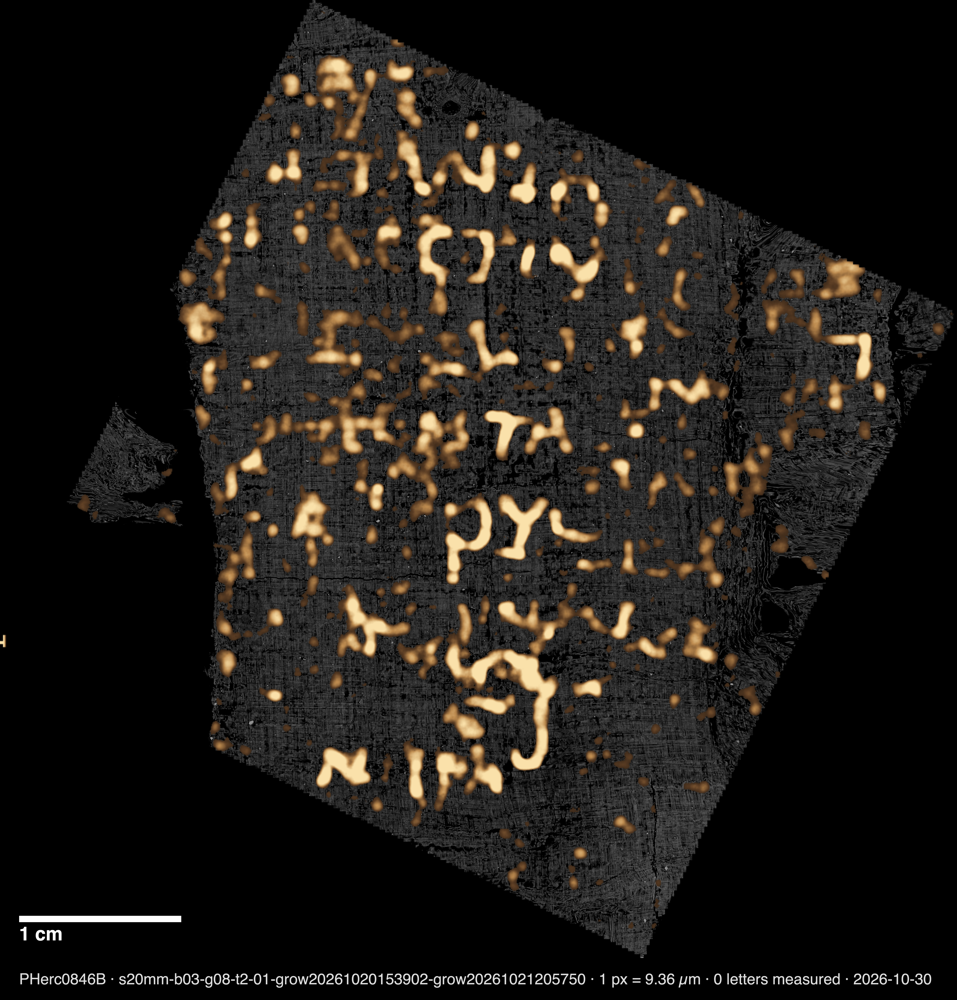
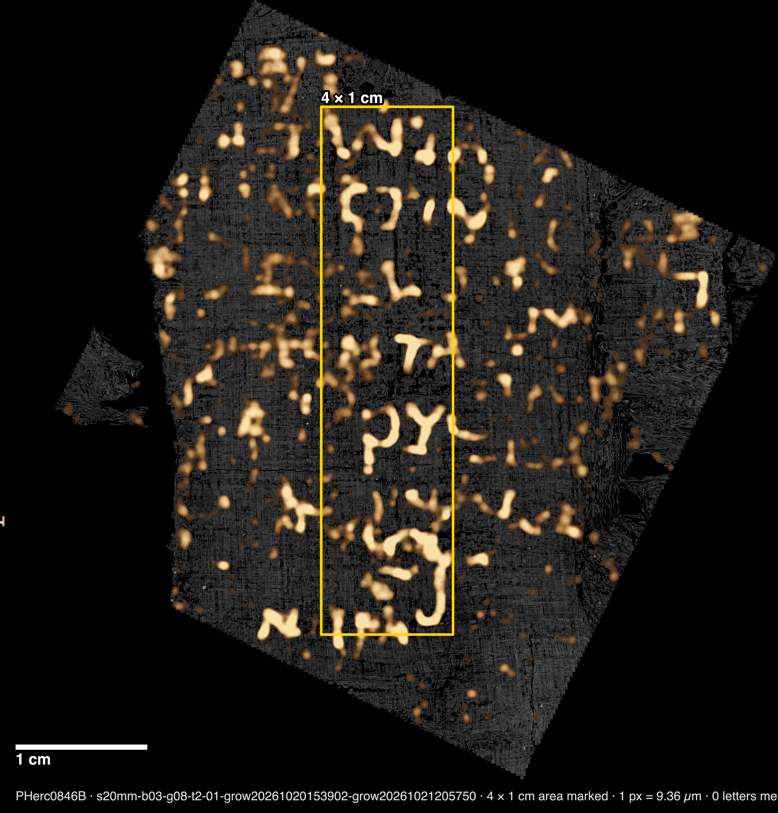
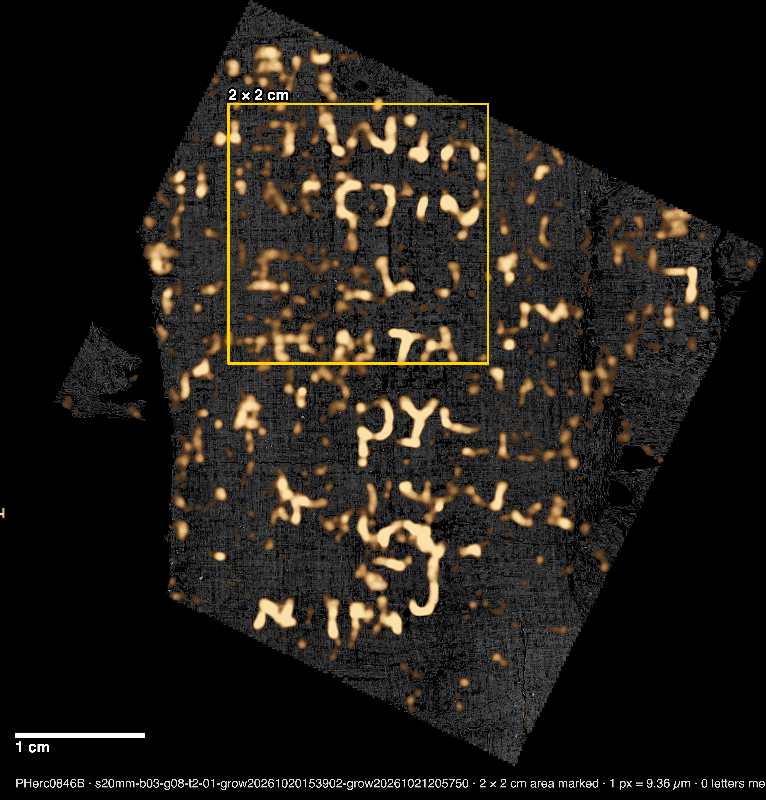
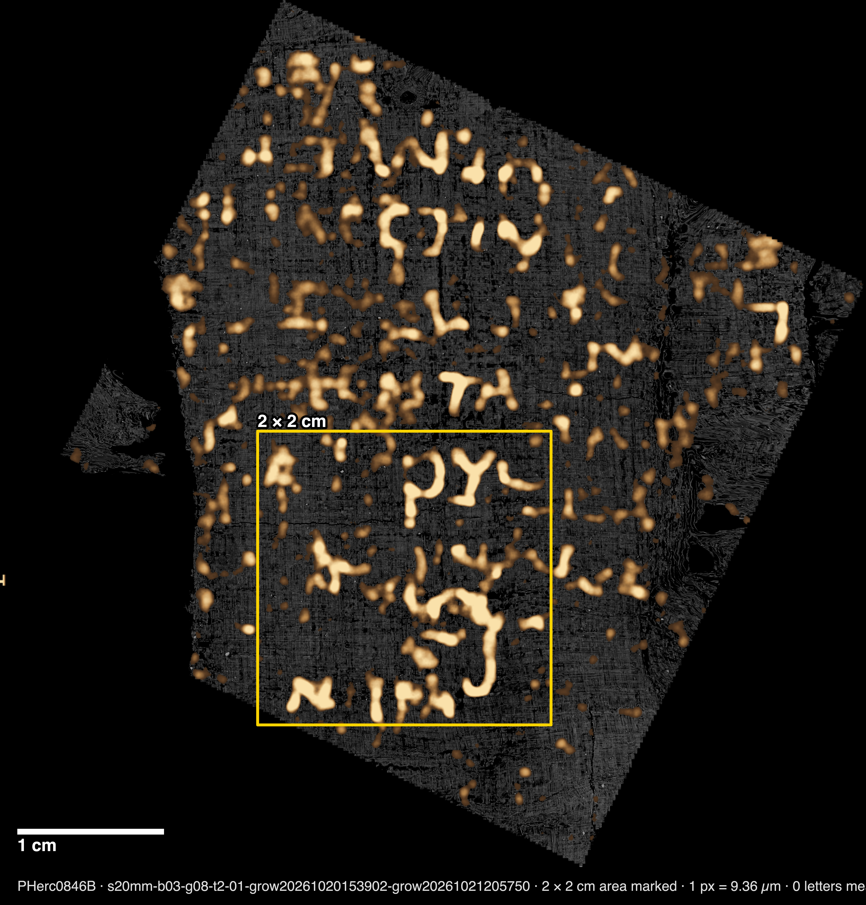
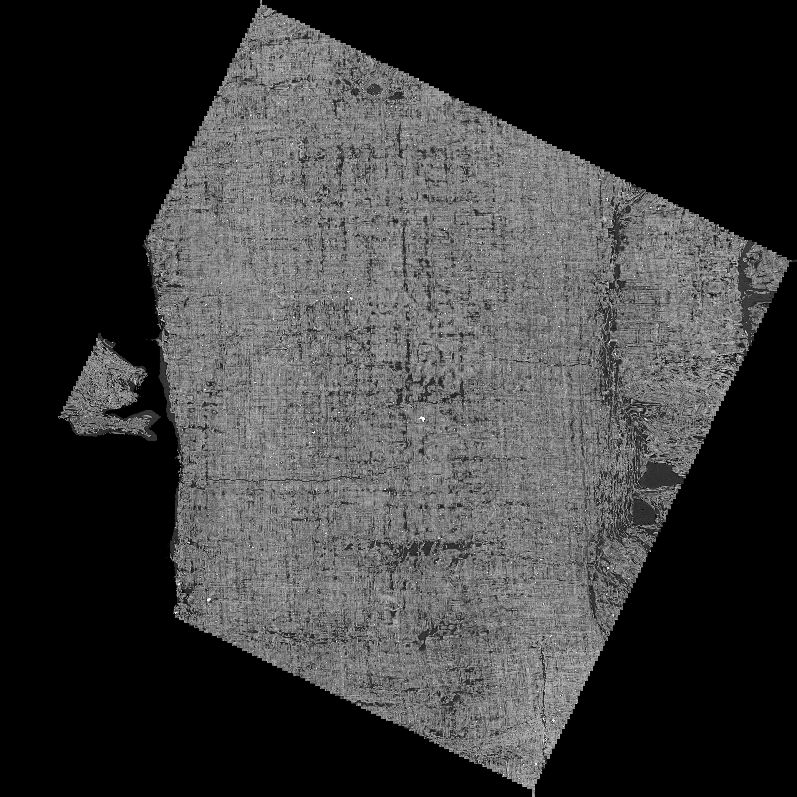
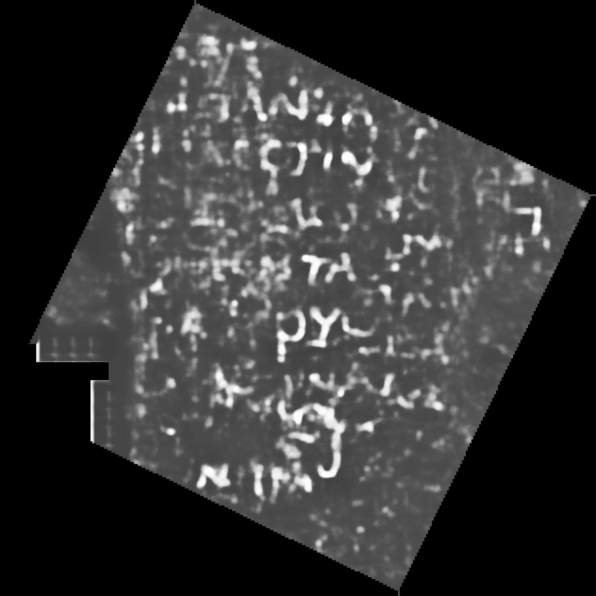

# PHerc0846B-s20mm-b03-g08-t2-01-grow20261020153902-grow20261021205750

## Post-processed

Screenshots of the reader-v3 prediction from the roldrop viewer, where the segment was found (cropped, and with the viewer's own display settings: rotation, mirroring, colour map or overlay on the CT). The raw prediction and the normalised prediction below are the reference outputs of this repository's pipeline.


*`screenshots/PHerc0846B-s20mm-b03-g08-t2-01-grow20261020153902-grow20261021205750/PHerc0846B_s20mm-b03-g08-t2-01-grow20261020153902-grow20261021205750_submission_2026-10-30.png`*


*`screenshots/PHerc0846B-s20mm-b03-g08-t2-01-grow20261020153902-grow20261021205750/PHerc0846B_s20mm-b03-g08-t2-01-grow20261020153902-grow20261021205750_submission_2026-10-30-2.png`*


*`screenshots/PHerc0846B-s20mm-b03-g08-t2-01-grow20261020153902-grow20261021205750/PHerc0846B_s20mm-b03-g08-t2-01-grow20261020153902-grow20261021205750_submission_2026-10-30-3.png`*


*`screenshots/PHerc0846B-s20mm-b03-g08-t2-01-grow20261020153902-grow20261021205750/PHerc0846B_s20mm-b03-g08-t2-01-grow20261020153902-grow20261021205750_submission_2026-10-30-4.png`*

## Segment

| | |
|---|---|
| Scroll | PHerc0846B |
| Segment | `PHerc0846B-s20mm-b03-g08-t2-01-grow20261020153902-grow20261021205750` |
| UUID | `d80dd1db-50bf-4d19-85ed-ad7f5e3c761d` |
| Kind | grown |
| Source | roldrop, exported as tifxyz: [`input/PHerc0846B-s20mm-b03-g08-t2-01-grow20261020153902-grow20261021205750/`](input/PHerc0846B-s20mm-b03-g08-t2-01-grow20261020153902-grow20261021205750/) |
| tifxyz grid | 316 × 316 points, scale 0.05 |
| Bounding box (level-0 voxels, x y z) | (1608, 2589, 1927) – (5600, 4297, 7956) |
| Area on the surface | 19.69 cm² |

## CT and inference

| | |
|---|---|
| CT volume | [`20250804142305-9.362um-1.2m-113keV-masked.zarr`](https://vesuvius-challenge-open-data.s3.amazonaws.com/PHerc0846B/volumes/20250804142305-9.362um-1.2m-113keV-masked.zarr) |
| Voxel size (level 0) | 9.362 µm |
| Pyramid level read | 0 (9.362 µm per pixel) |
| Umbilicus (x, y) | centre of the volume |
| Normals | towards the umbilicus |
| Surface volume | 17 layers, 1 voxel apart, centred on the surface, trilinear |
| Model | [domenicor046/reader-v3](https://huggingface.co/domenicor046/reader-v3/tree/39f626e595304c35c6ef574ffc0b6cc1e0ed44cb) @ `39f626e5`, `reader-v3.pth` |
| Inference | villa `vesuvius.ink_detection.inference.infer` @ [`b29f310`](https://github.com/ScrollPrize/villa/tree/b29f310957c7b29e7d332f9876e0e487819cfaa3/vesuvius), 384 px patches, 50 % overlap, Hann blend, forward |
| Settings | [`input/PHerc0846B-s20mm-b03-g08-t2-01-grow20261020153902-grow20261021205750.json`](input/PHerc0846B-s20mm-b03-g08-t2-01-grow20261020153902-grow20261021205750.json) |
| Output size | 6320 × 6320 px (full resolution, nothing downsampled) |

## Raw CT

The CT on the traced surface: layer 8 of 17 (the centre layer) of the surface
volume reader-v3 reads.



File: [`output/PHerc0846B-s20mm-b03-g08-t2-01-grow20261020153902-grow20261021205750_surface.png`](output/PHerc0846B-s20mm-b03-g08-t2-01-grow20261020153902-grow20261021205750_surface.png)

## Raw prediction

reader-v3's sigmoid probability × 255, straight from villa's inference: not windowed, not normalised.
GitHub cannot show TIFF files in the browser; download the file to view it.

| | |
|---|---|
| File | [`output/PHerc0846B-s20mm-b03-g08-t2-01-grow20261020153902-grow20261021205750_reader-v3_raw.tif`](output/PHerc0846B-s20mm-b03-g08-t2-01-grow20261020153902-grow20261021205750_reader-v3_raw.tif) |
| Type | uint8, 6320 × 6320 px |
| Range | 0 – 231 (of 0 – 255) |

## Normalised prediction

The raw prediction linearly windowed to 0 – 255 between its 1st and 99.9th percentile over the segment (pixels off
the segment are 0); `normalise()` in [`infer_letters.py`](infer_letters.py).



File: [`output/PHerc0846B-s20mm-b03-g08-t2-01-grow20261020153902-grow20261021205750_reader-v3.png`](output/PHerc0846B-s20mm-b03-g08-t2-01-grow20261020153902-grow20261021205750_reader-v3.png)

## Reproduce

```bash
uv venv --python 3.14 .venv && uv pip install --python .venv -r requirements.txt
.venv/bin/python infer_letters.py PHerc0846B-s20mm-b03-g08-t2-01-grow20261020153902-grow20261021205750
```
